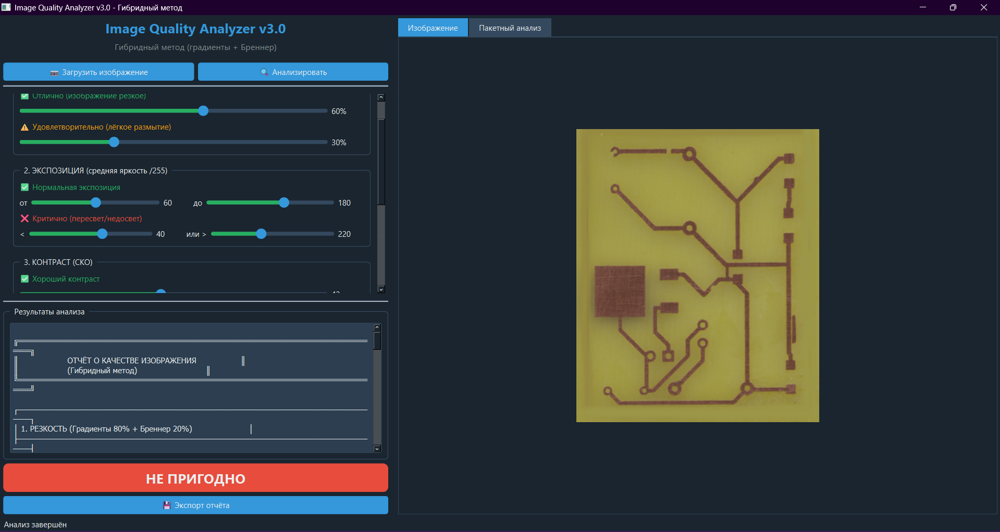

# 🔬 Image Quality Analyzer (IQA)

[](https://python.org)
[](https://doc.qt.io/qtforpython/)
[](LICENSE)
[]()

**Автоматическая оценка качества изображений** для AOI-систем контроля печатных плат и микросхем.

---

## 📋 О проекте

Программа оценивает качество фотографий по **четырём критериям**:

| Критерий | Метод | Порог |
|----------|-------|-------|
| **Резкость** | Гибридный метод (Бреннер + Лапласиан + градиенты) | ≥ 25 |
| **Экспозиция** | Средняя яркость | 60–180 |
| **Контраст** | Дисперсия | ≥ 45 |
| **Шум** | SNR (медианная фильтрация) | ≥ 40 дБ |

**Вердикт:** изображение считается **ПРИГОДНЫМ** только при прохождении всех четырёх критериев (логика AND).

---

## 🚀 Возможности

- 📷 **Одиночный анализ** — загрузка одного изображения, детальный отчёт
- 📁 **Пакетный анализ** — обработка всех изображений в папке
- 🎛️ **Настройка порогов** — изменение порогов в реальном времени
- 📊 **Экспорт CSV** — сохранение результатов в табличном формате
- 📈 **Гистограмма** — визуализация распределения яркости
- 🖥️ **Кроссплатформенность** — работает на Windows, Linux, macOS

---

## 📷 Скриншоты

| Главное окно | Пакетный анализ |
|--------------|-----------------|
|  |  |

---

## 📁 Установка и запуск

```bash
# Клонирование репозитория
git clone https://github.com/yourusername/IC_Quality_Analyzer.git
cd IC_Quality_Analyzer

# Установка зависимостей
pip install -r requirements.txt

# Запуск программы
python main.py

Тестирование
Для проверки точности классификации:
# Создание 1000 тестовых изображений
python create_test_images.py

# Расчёт точности и СКО
python accuracy_test.py

Научные результаты (ВКР)
Разработано в рамках выпускной квалификационной работы УрФУ, направление «Электроника и наноэлектроника».

Научная новизна: предложен гибридный метод оценки резкости

Практическая значимость: приложение готово к внедрению в AOI-системы

Лицензия
MIT License — свободное использование, модификация и распространение.

Автор
Шестаков Матвей Александрович
УрФУ, Физико-технологический институт
Направление: Электроника и наноэлектроника
Группа: Фт-420009